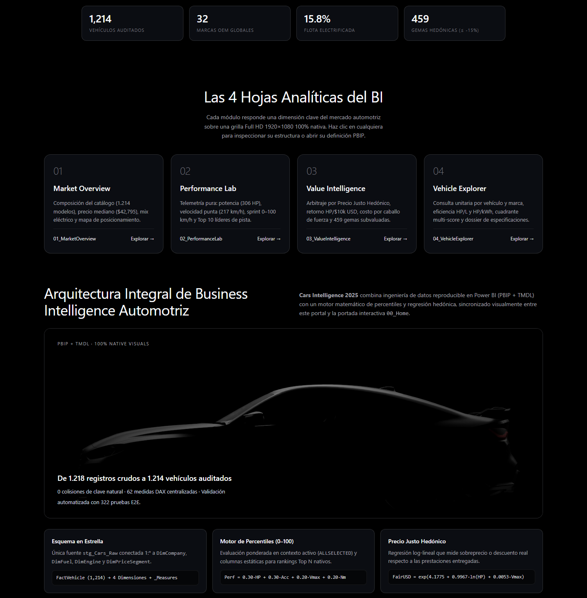
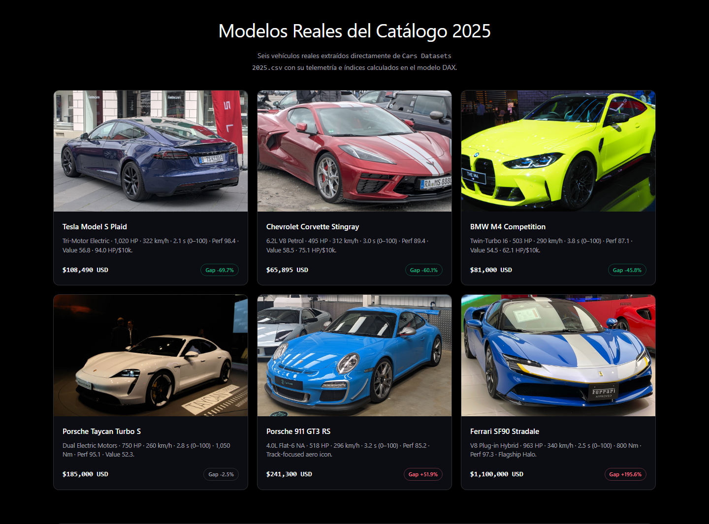

# Cars Intelligence 2025

Proyecto de inteligencia de mercado y rendimiento automotriz, construido como experiencia analítica inmersiva sobre el dataset [Cars Datasets (2025)](https://www.kaggle.com/datasets/abdulmalik1518/cars-datasets-2025).

**Stack:** Power BI · DAX · SVG · HTML/CSS · MCP · GitHub

<p align="center">
  
</p>

## Objetivo

Transformar el dataset crudo en una interfaz de **Automotive Market & Performance Intelligence**: no un catálogo de autos, sino una herramienta para explorar precio, prestaciones, motorización y posicionamiento relativo de cada vehículo frente al mercado.

## Estado actual

🟢 **Checkpoints 1–10 completos — Proyecto finalizado y listo para portafolio** (`00_Home` en tema claro minimalista, 4 hojas analíticas Power BI `1920×1080`, Portal Web `html/index.html`, validador MCP + CI GitHub Actions y documentación final)

| Checkpoint | Objetivo | Estado |
|---|---|---|
| 1 | Repositorio, estructura PBIP, staging inicial | ✅ |
| 2 | Limpieza y normalización (Price, HP, Performance, Seats, Fuel, CC/Battery) | ✅ |
| 3 | Modelo dimensional (`DimCompany`, `DimFuel`, `DimEngine`, `DimPriceSegment` → `FactVehicle`) | ✅ |
| 4 | Auditoría de calidad de datos (`qa_Cars_Audit`, detección de duplicados) | ✅ |
| 5 | Scores de rendimiento y valor (`Performance Index`, `Value Index`, `Market Position`) y regresión hedónica | ✅ |
| 6 | Design System y 5 páginas Power BI (`00_Home` tema claro minimalista con `actionButton` + `01_MarketOverview`, `02_PerformanceLab`, `03_ValueIntelligence`, `04_VehicleExplorer` en Bento Grid `1920×1080`) | ✅ |
| 7 | Verificación automatizada PBIR (`scripts/verify_report.py`, 55 checks) y suite E2E multi-página (`tests/`, 322 tests) | ✅ |
| 8 | Portal introductorio HTML/CSS (`html/index.html`) estilo Obsidian Dark Luxury con fotos reales de autos, resumen BI y links a las 4 hojas | ✅ |
| 9 | MCP: validación de modelo (`scripts/validate_model_mcp.py`) y flujo reproducible en CI ([`.github/workflows/pbip-validate.yml`](.github/workflows/pbip-validate.yml)) | ✅ |
| 10 | Performance, documentación final, screenshots y ficha de portafolio | ✅ |

## Arquitectura de datos

**Ingesta consolidada en una sola fuente de verdad.** Todas las tablas del modelo (`FactVehicle`, `DimCompany`, `DimFuel`, `DimEngine`, tablas `qa_*`) referencian una única query de staging, `stg_Cars_Raw`, en vez de reprocesar el CSV crudo de forma independiente. Esto se corrigió durante el desarrollo (ver *Decisiones y hallazgos de calidad* abajo) para que el proyecto sea reproducible al clonarlo.

```
stg_Cars_Raw (única lectura + limpieza del CSV, vía parámetro pDataFolder)
      │
      ├── FactVehicle   (hechos: un registro por vehículo)
      ├── DimCompany    (marca, deduplicada)
      ├── DimFuel       (grupo de combustible, deduplicado)
      ├── DimEngine     (motor normalizado, deduplicado)
      └── qa_*          (auditoría de calidad y duplicados)
```

**Modelo semántico:** esquema en estrella, relaciones 1:* de `FactVehicle` hacia cada dimensión, formato **PBIP + TMDL** (texto plano) para que los cambios se puedan revisar como diffs legibles en cada Pull Request.

### Reproducir el proyecto localmente

1. Clona el repositorio y coloca el CSV en `data/raw/Cars Datasets 2025.csv`.
2. Abre `CarsIntelligence.pbip` en Power BI Desktop.
3. En **Transformar datos → Administrar parámetros**, actualiza `pDataFolder` con la ruta local a tu carpeta `data/raw`.
4. Actualiza el modelo (Inicio → Actualizar).

## Modelo DAX

Todas las medidas viven centralizadas en una tabla aislada, **`_Measures`** (migradas desde `FactVehicle`/`DimCompany` antes de iniciar el Checkpoint 6), organizadas por `displayFolder`:

- **`_CORE`** — Conteos base (Vehicle Count, Company Count).
- **`_PRICE` / `_PERFORMANCE`** — Estadísticos descriptivos (Average, Median, Min, Max) de precio, potencia, velocidad, aceleración y torque.
- **`_PROFILE`** — Percentiles P25/P75 para entender la dispersión real del mercado.
- **`_DATA_QUALITY`** — Tasa de calidad, vehículos con incidencias, colisiones de clave natural.
- **`_SCORES`** — Índices de rendimiento y valor (Checkpoint 5): `Score HP`, `Score Speed`, `Score Acceleration`, `Score Torque`, `Performance Index`, `Score Price (Inverted)`, `Value Index`, `Market Position`. Percentil robusto (0–100) dentro del contexto de filtro activo (`ALLSELECTED`), con blancos propagados explícitamente en vez de tratados como 0.

**Columnas `(Static)` en `FactVehicle`** — versión paralela de los 8 scores anteriores, como columnas calculadas (contexto de fila nativo, referencian `ALL(FactVehicle)` en vez de `ALLSELECTED`). Se usan específicamente donde Power BI necesita un valor ya resuelto —Top N nativo y Filtro básico con checkboxes—, algo que una medida no puede ofrecer de forma confiable. Las medidas originales se mantienen para KPIs y gráficos que sí deben reaccionar a filtros de Company/Fuel/Engine. El porqué de esta distinción, con la cadena de errores que llevó a adoptarla, está documentado en [`docs/dax-gotchas.md`](docs/dax-gotchas.md).

## Decisiones y hallazgos de calidad de datos

Durante el Checkpoint 4/5 se auditó la clave de identidad de vehículo (`Vehicle_NaturalKey`) y se encontraron 9 colisiones aparentes. La investigación reveló dos causas distintas, resueltas de forma diferenciada:

1. **Clave insuficiente:** la clave original (`Company|Car_Name|Engine_Raw`) no distinguía variantes/trims con distinto precio, potencia o combustible. Se amplió a una huella de los 11 campos crudos del dataset.
2. **Duplicados de carga reales:** tras ampliar la clave, quedaron 4 filas idénticas en todos los campos salvo el índice técnico — duplicados genuinos del CSV original. Se eliminaron.

**Resultado:** de 1.218 filas originales → **1.214 vehículos únicos**, con 0 colisiones de clave natural.

## Documentación técnica

- [`docs/design-system-premium.md`](docs/design-system-premium.md) — dirección visual del dashboard (paleta, tipografía, motion, inventario de componentes), grid de implementación en Full HD y convención de la página `_QA_DAX_Profiling`.
- [`docs/dax-gotchas.md`](docs/dax-gotchas.md) — lecciones de DAX documentadas a partir de errores reales del proyecto (manejo de blancos, límites del Filtro básico sobre medidas, empates de `RANKX`, contexto de fila vs. agregación, y el criterio medida-vs-columna para ranking/Top N).
- [`docs/mcp-validation-workflow.md`](docs/mcp-validation-workflow.md) — validación reproducible con Power BI Modeling MCP (`powerbi-modeling-mcp`), consultas DAX de auditoría y pipeline headless CI.
- [`docs/performance-and-portfolio.md`](docs/performance-and-portfolio.md) — auditoría de performance VertiPaq/PBIR ($\le 20$ visuales por página), hallazgos del catálogo y ficha ejecutiva de portafolio.
- [`.github/workflows/pbip-validate.yml`](.github/workflows/pbip-validate.yml) — workflow automático en GitHub Actions que ejecuta verificación PBIR, validador MCP/TMDL y la suite E2E en cada `push` y `pull_request`.

## Dataset

Fuente: [Cars Datasets (2025) — Kaggle](https://www.kaggle.com/datasets/abdulmalik1518/cars-datasets-2025)
Columnas originales: Company, Car Name, Engine, CC/Battery Capacity, HorsePower, Total Speed, Performance (0-100 km/h), Price, Fuel Type, Seats, Torque.

## Páginas del reporte y portal introductorio

- **Portal Web Introductorio:** [`html/index.html`](html/index.html) — landing page en estética *Obsidian Dark Luxury* con resumen ejecutivo del BI completo, galería de vehículos reales con telemetría verificada, inspector de blueprint y enlaces directos a las 4 hojas analíticas.
- **`00_Home`** (`a001c6b7a0e103746570`) — portada minimalista en tema claro (`#F8FAFC` / `#FFFFFF`) estilo web moderno con 12 visuales nativos (0 gráficos saturados), 4 KPIs globales, resumen de arquitectura y 4 tarjetas interactivas (`actionButton` con `PageNavigation`) + `pageNavigator` para viajar directamente a cada módulo.
- **`01_MarketOverview`** (`3f7688a2cc2e12e049b0`) — panorama de catálogo, segmentos de precio, mix de motorización y posicionamiento general.
- **`02_PerformanceLab`** (`deb9f8692d454328e800`) — dinámica de tren motriz, telemetría de pista (`HP`, `Speed`, `0-100`, `Torque`) y `Performance Index`.
- **`03_ValueIntelligence`** (`c033c6b7a0e103746573`) — retorno por dólar (`HP per 10k USD`, `Price per HP`), modelo econométrico de `Hedonic Fair Price` y gemas subvaluadas (`459` vehículos con brecha $\le -15\%$).
- **`04_VehicleExplorer`** (`d044c6b7a0e103746574`) — explorador granular por vehículo/marca, eficiencia (`Specific Output`, `EV Power Density`) y dossier maestro de especificaciones.

## Verificación y pruebas automatizadas

```bash
python scripts/verify_report.py      # 55 checks de esquema PBIR, UTF-8 sin BOM, bindings DAX y colisiones
python scripts/validate_model_mcp.py # Validador MCP/CI de modelo TMDL, staging M, 71 medidas DAX y presupuesto visual
python tests/run_e2e_tests.py        # Suite E2E de 5 niveles (309 tests)
python -m pytest tests/ -q           # Suite completa con mutaciones adversariales (322 tests)
```

## Galería / Portafolio

| Módulos Analíticos y Arquitectura | Showroom de Modelos Reales (2025) |
|---|---|
|  |  |

## Portafolio y uso

- **Explorar sin licencia de Power BI**: abre [`html/index.html`](html/index.html) en tu navegador para recorrer el resumen ejecutivo, las métricas globales, las tarjetas de vehículos reales y el blueprint técnico de las 4 hojas analíticas.
- **Explorar en Power BI Desktop**: abre [`powerbi/CarsIntelligence.pbip`](powerbi/CarsIntelligence.pbip) desde `00_Home` y viaja por `01_MarketOverview`, `02_PerformanceLab`, `03_ValueIntelligence` y `04_VehicleExplorer` aplicando los segmentadores interactivos de segmento, motorización, marca y alcance.
